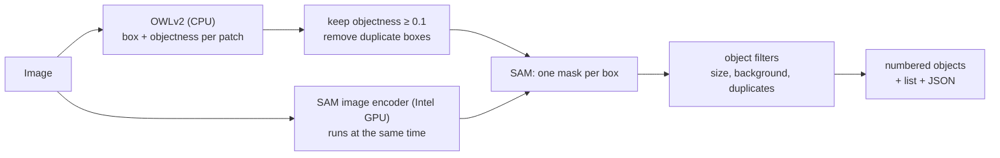

# OWLv2 + SAM Object Finder: find and count objects without labels

You give it an image full of objects. It returns:

- the image with a **numbered box and a coloured mask on every object**, and
- a **scrollable list** beside the image with the total object count and every object (size and score).

There is no prompt and no naming. **OWLv2** puts a box around everything that looks like a whole object, and **SAM** (Segment Anything) outlines the object inside each box. This replaces the grid of points used by `sam-segment-only`. On the test video it finds more of the items and runs faster:

| Test: 13 frames of `before-video-002`, 149 marked items | `sam-segment-only` (grid) | **this app** |
|---|---|---|
| Items found as one whole object (IoU ≥ 0.5) | 66% | **81%** |
| Items outlined tightly (IoU ≥ 0.75) | 51% | **60%** |
| Time per frame (laptop, Core Ultra 7 155U) | 14.3 s | **8.7 s** |



> How it works in detail: **[docs/HOW_IT_WORKS.md](docs/HOW_IT_WORKS.md)**

---

## Quick start (Linux + NVIDIA GPU)

```bash
./run_app.sh                       # web app at http://127.0.0.1:7862
./run_folder.sh /path/to/images    # batch: annotated images + CSVs in outputs/batch_<timestamp>/
```

Same setup as on Windows (uv, environment in `~/.venvs/owl-sam-segment`, models in `~/.cache/huggingface`), but with the CUDA build of PyTorch. With an NVIDIA GPU everything runs on the GPU in strict fp32, so the results are the same as on the CPU:

| Workstation (Threadripper 7970X + RTX A5000), per image | original code* | **CUDA backend** |
|---|---|---|
| `crushed_cans.jpg` (166 objects) | 14.2 s | **0.68 s** |
| `kitchen.jpg` (51 objects) | 6.2 s | **0.33 s** |
| `recycling.jpg` (5 objects) | 4.4 s | **0.27 s** |
| 2048 × 2048 belt frame | 4.0 s | **0.30 s** |

\* On this machine the original code fell back to PyTorch on the CPU: OpenVINO lists the NVIDIA card as "GPU" but cannot compile for it. Same objects in both columns (boxes and mask areas identical or within float rounding).

Folder batches run at about 0.3 s per image after the models are loaded. The first start compiles the models for the GPU (`torch.compile`, a few minutes once; later starts about 15 s). `OWLSEG_COMPILE=0` skips it (~10% slower per image, starts in seconds).

## Quick start (Windows)

**Double-click `Run App.bat`.**

The first start installs `uv` (a Python package manager), Python 3.11 and the packages (~1 GB), then downloads OWLv2 and SAM (~1 GB). The first image after that also prepares the models for this computer (about a minute, once). Later starts take a few seconds and work offline.

Your browser opens at **http://127.0.0.1:7862**. Keep the console window open while you use the app; closing it stops the app. Port 7862 lets it run next to the other two apps (7860, 7861).

> The Python environment lives in `%USERPROFILE%\.venvs\owl-sam-segment`, outside the project folder, because OneDrive breaks virtual environments. Model weights are in `%USERPROFILE%\.cache\huggingface`, the prepared models in `%USERPROFILE%\.cache\owlseg-openvino`.

## Using the app

1. Drop an image into **Input image** and press **Find objects**.
2. Wait about 8–10 s on a laptop with an Intel integrated GPU. The progress bar shows each step.
3. Read the results:
   - **Middle:** every object has its own colour and number. With more than 30 objects only the numbers are shown.
   - **Right:** the scrollable list: *Total objects detected*, then each object with its size (% of the image) and score.
   - **Below:** the time per stage and a JSON file with all objects.

Each run also saves `outputs/<image>_<timestamp>_annotated.png` and a matching `.json`.

### Settings

| Setting | What it does | When to change it |
|---|---|---|
| Objectness threshold | How sure OWLv2 must be that a box holds a whole object (default 0.1). | Lower it if objects are missed; raise it if there is junk. |
| Min object size | Smallest object kept, as % of the image. | Lower it for tiny items. |
| Max object size | Larger regions are treated as background. | Raise it when single objects are big in the frame. |
| Show masks / Box labels | Display options. | Crowded images. |

The score of an object is SAM's mask quality × OWLv2's objectness.

## Processing a whole folder

**Drag a folder of images onto `Run on Folder.bat`**, or double-click it and paste the folder path. Every image (`.jpg .jpeg .png .bmp .tif .tiff .webp`) is processed with the default settings. When it finishes, the results folder opens, `outputs\batch_<timestamp>\`:

| File | Contents |
|---|---|
| `annotated\<image>.png` | annotated image for each input |
| `summary.csv` | one row per image: `objects`, `time_s` |
| `objects.csv` | one row per object: `image, id, score, x0, y0, x1, y1, mask_area_px, mask_area_pct` |

At about 9 s per image, 60 images take about 9 minutes. From the command line: `uv run python scripts\batch.py <folder> --objectness 0.15 --out <dir>`.

## Command line

```powershell
$env:UV_PROJECT_ENVIRONMENT = "$env:USERPROFILE\.venvs\owl-sam-segment"   # same env as Run App.bat

uv run python -m owlseg.pipeline samples\crushed_cans.jpg          # one image -> outputs\
uv run python -m owlseg.pipeline img.jpg --objectness 0.15
uv run python app.py                                               # the web app
```

## Troubleshooting

| Problem | Fix |
|---|---|
| `WinError 1314 ... privilege` while downloading | Already handled (single-threaded download). Otherwise enable Windows Developer Mode and rerun. |
| `Access is denied` inside the environment | The launcher clears read-only flags and retries. If it still fails, delete `%USERPROFILE%\.venvs\owl-sam-segment` and rerun `Run App.bat`. |
| The app says a model is missing (offline mode) | Delete `%USERPROFILE%\.venvs\owl-sam-segment\.models_ok` and rerun `Run App.bat` with internet access. |
| Port 7862 in use | Close the other window or change `PORT` in `app.py`. |
| Slower than ~10 s per image | The console prints `[owlseg] backend: ...` at the first image. If it does not say `SAM on GPU`, the Intel GPU is not used; updating the Intel graphics driver usually fixes it. |
| Strange results after an update of OpenVINO/transformers | Delete `%USERPROFILE%\.cache\owlseg-openvino`; the models are prepared again on the next start. |

## Project layout

```
Run App.bat               double-click launcher (setup + start the web app)
Run on Folder.bat         drag a folder onto it: batch-process all images -> CSV + annotated images
run_app.sh, run_folder.sh the same two launchers for Linux
app.py                    Gradio web UI
src/owlseg/
  engine.py               OWLv2 boxes -> SAM masks; CUDA, OpenVINO (CPU + Intel GPU) or PyTorch CPU
  fast_attention.py       fused fp32 attention for the CUDA backend
  fast_decoder.py         SAM mask decoder that shares the per-image work across all boxes (CUDA backend)
  filters.py              keep real objects: drop specks, background, duplicates
  pipeline.py             end-to-end pipeline, progress bar, CLI
  visualize.py            annotated image + scrollable HTML list
  models.py               model ids
scripts/
  setup.bat               shared setup used by both launchers (uv, environment, models)
  download_models.py      pre-download OWLv2 and SAM
  batch.py                folder batch processing (used by Run on Folder.bat)
samples/                  test images (see samples/SOURCES.md)
docs/HOW_IT_WORKS.md      design and implementation notes
```

## Credits

- **OWLv2:** Google Research, https://huggingface.co/google/owlv2-base-patch16-ensemble (Apache-2.0)
- **Segment Anything (SAM):** Meta AI, https://github.com/facebookresearch/segment-anything (Apache-2.0)
- Both used via Hugging Face `transformers` and Intel OpenVINO.
